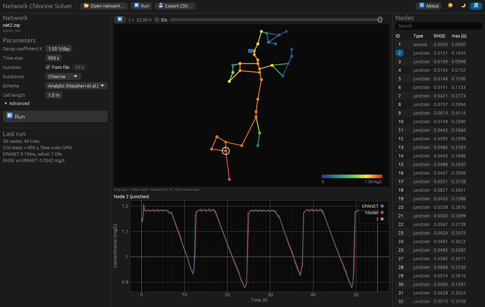

# Network Chlorine Solver

Simulates the transport, dispersion and first-order decay of chlorine (or fluoride) in drinking water distribution networks. Hydraulics come from an EPANET model; pipe transport uses the analytical solution of the one-dimensional advection–dispersion–reaction equation by Mazaheri et al. (2013), so longitudinal dispersion, which EPANET's plug-flow model ignores, is taken into account.

It comes as a desktop application and a command-line tool, both written in Rust.



## Features

- Opens any EPANET 2.x `.inp` file; all EPANET flow units are converted to SI.
- Reservoirs, tanks, negative-demand nodes and `[SOURCES]` nodes are used as sources.
- Pipe transport by the analytical solution of Mazaheri et al. (2013), extended to time-varying velocity (see [Method](#method)).
- Handles looped networks, flow reversals, stagnant pipes, pumps and valves.
- Compares every node with EPANET's own water quality result (RMSE, maximum difference).
- Desktop application: network map coloured by concentration with a time slider and playback, time series plots, node table, CSV export.
- Command-line tool for batch runs and scripting.
- The original Python implementation is kept as the `legacy` scheme to reproduce earlier results.

## Getting started

### Build from source

Requirements:

- [Rust](https://rustup.rs) (stable)
- A C compiler for EPANET: Visual Studio Build Tools with the C++ workload on Windows, `gcc` or `clang` on Linux and macOS

```bash
git clone --recursive https://github.com/gorkem787/Network_Chlorine_Solver.git
cd Network_Chlorine_Solver
cargo build --release
```

If you cloned without `--recursive`, fetch the EPANET sources with `git submodule update --init`.

This produces two programs in `target/release/`:

| Program | Description |
|---|---|
| `chlorine-gui` | Desktop application |
| `chlorine` | Command-line tool |

EPANET is compiled into both, so they run without any other files or installation.

### Desktop application

Start `chlorine-gui`, open a network with **Open network…** (or drop an `.inp` file onto the window), set the parameters and press **Run**. You can also open a file directly:

```bash
chlorine-gui path/to/network.inp --run
```

- **Map:** drag to pan, scroll to zoom, double-click to fit, click a node to select it.
- **Time slider / ▶:** shows the concentration at any time; the selected time is marked on the plot.
- **Plot:** model (solid) and EPANET (dashed) concentration at the selected node.
- **Export CSV…:** writes all node time series.

### Command line

```bash
chlorine epanet_net2/net2.inp -k 1.5 --hours 55 -o results.csv
```

| Option | Meaning | Default |
|---|---|---|
| `-k` | Bulk decay coefficient K, 1/day | 1.0 |
| `--dt` | Time step, s (whole seconds) | 900 |
| `--hours` | Simulation duration, h | duration in the `.inp` file |
| `--segment` | Pipe profile cell length, m | 1.0 |
| `--species` | `chlorine` or `fluorine` dispersion model | `chlorine` |
| `--scheme` | `analytic` or `legacy` (original Python scheme) | `analytic` |
| `--keep-epanet-reactions` | Use the `.inp` reaction coefficients in the EPANET reference run instead of K | off |
| `-o`, `--out` | CSV output: `node_id,time_h,model,epanet` | none |

Run `chlorine --help` for all options.

## Method

Concentration `C(x, t)` in a pipe obeys

```
∂C/∂t = −U ∂C/∂x + D ∂²C/∂x² − K C
```

with flow velocity `U`, longitudinal dispersion coefficient `D` and first-order bulk decay coefficient `K`.

**Analytical solution.** Mazaheri et al. (2013) derive the solution for a semi-infinite domain with a linear-pulse source at the inlet and a uniform initial concentration (their Eqs. 13–15). They extend it by superposition to an arbitrary piecewise-linear source pattern (Eq. 16). Here, each pipe is one domain whose source is the concentration at its upstream node, sampled at every time step.

**Time-varying velocity.** The solution requires constant `U` and `D`. In a network, velocity in a pipe is piecewise constant in time, changing at hydraulic events. Within each constant-velocity period, the concentration is the sum of:

1. Eq. 16 over the inlet history since the period began;
2. the evolution of the in-pipe profile present at the start of the period, with a zero inlet. This is the paper's initial-condition term generalised from a uniform concentration to a piecewise-constant profile using the method of images. For a single uniform cell it reduces exactly to the paper's term.

When the velocity changes, the profile is evaluated on cells that move with the flow, and the next period starts from it. Because the equation is linear, this restart is exact apart from representing the profile on cells. Water that has left the pipe is kept for a few dispersion lengths beyond the outlet, consistent with the semi-infinite domain (`∂C/∂x → 0` as `x → ∞`).

**Network.** At each time step, nodes are visited in flow order. A junction's concentration is the flow-weighted mix of its inflows. Sources take their concentration from EPANET. Pumps and valves pass concentration through unchanged. Directed flow cycles through pumps are detected and broken instead of stalling the run.

**Dispersion coefficient.** `D = a · Re^b` with `Re = U d / ν`:

| Species | a | b | ν (m²/s) |
|---|---|---|---|
| Chlorine | 1·10⁻⁴ | 0.66 | 1.26·10⁻⁶ |
| Fluoride | 2·10⁻⁵ | 0.83 | 1.0533·10⁻⁶ |

**Numerics.** Products such as `exp(p)·erfc(z)` are evaluated in log space, so slow flow and long pipes do not overflow.

## Validation

The test suite (`cargo test --release --workspace`) checks the solver against independent references:

| Test | Result |
|---|---|
| Constant velocity vs. Mazaheri et al. (2013) Eq. 16 | max. difference 4·10⁻¹⁵ |
| Time-varying velocity vs. Crank–Nicolson finite differences (0.25 m, 1 s) | max. difference 6·10⁻⁴ mg/L |
| Same problem with Δt = 900, 300 and 60 s | identical to 10⁻¹⁵ |
| Vanishing dispersion vs. plug flow | max. difference < 10⁻³ mg/L |
| Legacy scheme vs. the original Python `ADE_solver.py` | identical to 10⁻¹² |

On EPANET example network 2 with dispersion switched off (`D → 0`), the result converges to EPANET's plug-flow solution as the time step decreases. With the empirical `D`, the remaining difference reflects dispersion.

## Repository layout

| Path | Contents |
|---|---|
| `crates/chlorine-core` | Solver: analytical pipe transport, network simulation, legacy scheme |
| `crates/chlorine-epanet` | Loads `.inp` files and EPANET results; comparison and CSV export |
| `crates/epanet-sys` | EPANET 2.2 built from source (git submodule) |
| `crates/chlorine-cli` | `chlorine` command-line tool |
| `crates/chlorine-gui` | `chlorine-gui` desktop application |
| `ADE.py`, `ADE_solver.py` | Original Python implementation (legacy) |
| `epanet_net1`, `epanet_net2`, … | Example networks |

## References

- Mazaheri, M., Samani, J. M. V., & Samani, H. M. V. (2013). Analytical solution to one-dimensional advection-diffusion equation with several point sources through arbitrary time-dependent emission rate patterns. *Journal of Agricultural Science and Technology*, 15, 1231–1245.
- Rossman, L. A., Woo, H., Tryby, M., Shang, F., Janke, R., & Haxton, T. (2020). *EPANET 2.2 User Manual*. U.S. Environmental Protection Agency, EPA/600/R-20/133.

## License

Copyright (C) 2024-2026 Gorkem Bora Candan

This program is free software: you can redistribute it and/or modify it under the terms of the GNU General Public License as published by the Free Software Foundation, either version 3 of the License, or (at your option) any later version. See [LICENSE](LICENSE).

It includes third-party components under their own licenses, among them EPANET 2.2 (MIT). The full list and license texts are in [THIRD_PARTY_LICENSES.txt](THIRD_PARTY_LICENSES.txt), which is regenerated with:

```bash
cargo about generate about.hbs -o THIRD_PARTY_LICENSES.txt
```

Issues and pull requests are welcome.
